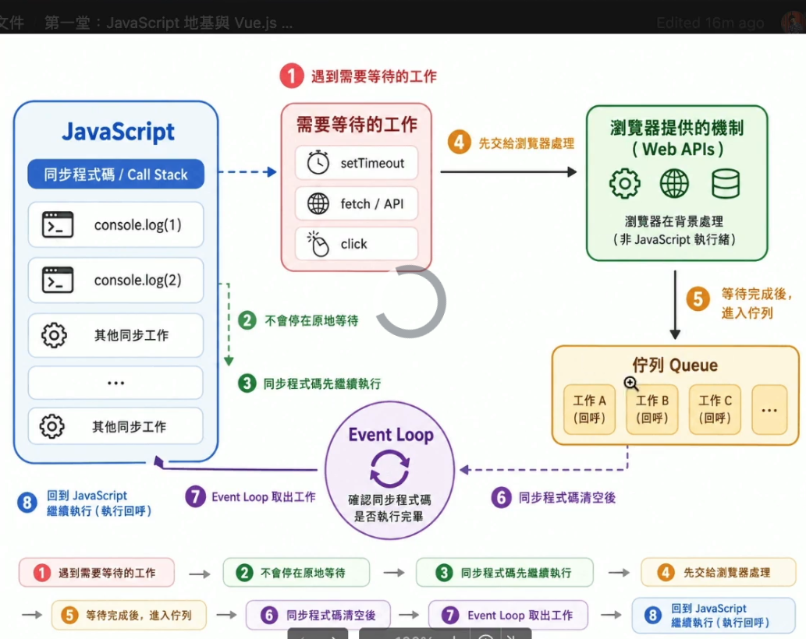
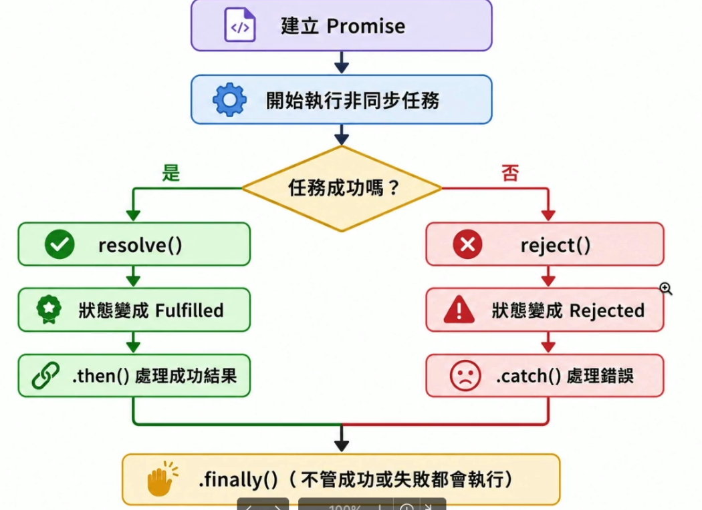

[🏠 回到首頁](../../README.md)

# 02-JavaScript 非同步處理與模組化

> 學 Vue 之前，必須先搞懂兩件事：
> 1. **非同步**：Vue 常常要向後端「要資料」（API），要資料需要時間，程式不能傻傻等 → 靠 `Promise` / `async await`
> 2. **模組化**：Vue 專案由很多 `.js`、`.vue` 檔案組成，檔案之間互相借用功能 → 靠 `export` / `import`

## 2.1 使用 Promise 處理非同步任務

### 1. 圖一：同步與非同步



#### 先認識名詞

| 名詞 | 白話說明 |
| --- | --- |
| 同步 (Synchronous) | 一件做完才做下一件，**排隊**。 |
| 非同步 (Asynchronous) | 遇到要等的事，**先交給別人處理，自己繼續往下做**，等結果好了再回來接手。 |
| Call Stack（呼叫堆疊） | JavaScript 執行程式的地方，**一次只能做一件事**（單執行緒）。 |
| Web APIs | 瀏覽器提供的幫手（計時器、網路請求、事件監聽），在背景工作，不佔用 JS 的時間。 |
| Queue（佇列） | 等待完成的工作（回呼函式 callback）排隊的地方。 |
| Event Loop（事件迴圈） | 一個不斷巡邏的管理員：「Call Stack 空了嗎？空了就從 Queue 拿一個工作進來執行。」 |

> 💡 比喻：餐廳點餐
> - **同步**：店員收下你的單，站在廚房門口等餐煮好，才幫下一位客人點餐 → 後面的人都在乾等。
> - **非同步**：店員收單後，把單子交給廚房（Web APIs），拿一個號碼牌給你，然後立刻服務下一位客人。餐好了，廚房把餐放到出餐口（Queue），店員（Event Loop）有空時再叫你取餐（執行回呼）。

#### 圖片的 8 個步驟

| 步驟 | 發生什麼事 | 對應餐廳比喻 |
| --- | --- | --- |
| ① 遇到需要等待的工作 | 例如 `setTimeout`、`fetch / API`、`click` | 客人點了一道要煮很久的菜 |
| ② 不會停在原地等待 | JS 不會卡住 | 店員不站著等 |
| ③ 同步程式碼先繼續執行 | 後面的 `console.log` 等照常執行 | 先服務下一位客人 |
| ④ 先交給瀏覽器處理 | 交給 Web APIs 在背景處理 | 單子交給廚房 |
| ⑤ 等待完成後，進入佇列 | 回呼函式排入 Queue | 煮好的菜放到出餐口 |
| ⑥ 同步程式碼清空後 | Event Loop 確認 Call Stack 已空 | 店員手邊沒事了 |
| ⑦ Event Loop 取出工作 | 從 Queue 拿一個回呼 | 拿起出餐口的菜 |
| ⑧ 回到 JavaScript 繼續執行 | 執行該回呼函式 | 把菜送到客人手上 |

#### 用程式碼驗證

```js
console.log("1");

setTimeout(() => {
  console.log("2（計時器）");
}, 0); // 即使是 0 毫秒也一樣

console.log("3");
```

輸出順序：

```
1
3
2（計時器）
```

**為什麼 `2` 最後才印？** 因為 `setTimeout` 被交給瀏覽器，即使 0 秒，回呼仍要進佇列排隊，**必須等所有同步程式（1、3）做完**，Event Loop 才會把它拿回來執行。

> ⚠️ 重點：非同步**不是**「同時做很多事」，JavaScript 依然一次只做一件事；它只是「不傻等」，把等待的部分交給瀏覽器。

### 2. 圖二：Promise 的流程



#### Promise 是什麼？

Promise（承諾）是一個物件，代表「**一個現在還不知道結果、但未來會有結果的任務**」。

> 💡 比喻：你在手搖飲店點飲料，店員給你一張**取餐單**（Promise）。這張單子保證：「飲料做好會通知你；萬一材料用完，也會告訴你失敗。」不會讓你一直不知道結果。

#### 三種狀態

| 狀態 | 意義 | 如何轉換 |
| --- | --- | --- |
| Pending（等待中） | 任務進行中，還沒結果 | 剛建立 Promise 時 |
| Fulfilled（已成功） | 任務成功 | 呼叫 `resolve()` |
| Rejected（已失敗） | 任務失敗 | 呼叫 `reject()` |

> 狀態一旦從 Pending 變成 Fulfilled 或 Rejected，就**不會再改變**（承諾不能反悔）。

#### 圖片流程解讀

1. **建立 Promise**：`new Promise(...)`
2. **開始執行非同步任務**：例如等待伺服器回應
3. **任務成功嗎？**
   - ✅ 是 → 呼叫 `resolve()` → 狀態變 **Fulfilled** → 由 `.then()` 處理成功結果
   - ❌ 否 → 呼叫 `reject()` → 狀態變 **Rejected** → 由 `.catch()` 處理錯誤
4. 最後 `.finally()`：**不管成功或失敗都會執行**（常用來關閉 loading 動畫）

| 方法 | 用途 | 何時執行 |
| --- | --- | --- |
| `.then(fn)` | 處理成功結果 | Fulfilled |
| `.catch(fn)` | 處理錯誤 | Rejected |
| `.finally(fn)` | 收尾工作 | 成功或失敗都會 |

### 3. 自訂 Promise 範例與說明

情境：模擬「買手搖飲」，製作需要 2 秒，且有可能材料不足而失敗。

```js
// 1. 建立 Promise
function orderDrink(name, hasMaterial) {
  return new Promise((resolve, reject) => {
    console.log(`店員開始製作 ${name}...`);

    setTimeout(() => {
      if (hasMaterial) {
        resolve(`${name} 做好了！`); // 成功：把結果傳出去
      } else {
        reject(new Error(`抱歉，${name} 材料用完了`)); // 失敗：把錯誤傳出去
      }
    }, 2000);
  });
}

// 2. 使用 Promise
orderDrink("珍珠奶茶", true)
  .then((result) => {
    console.log(result); // 珍珠奶茶 做好了！
  })
  .catch((error) => {
    console.error(error.message);
  })
  .finally(() => {
    console.log("結帳完成，謝謝光臨"); // 不管成功失敗都會執行
  });
```

#### 逐段說明

| 程式碼 | 說明 |
| --- | --- |
| `new Promise((resolve, reject) => {...})` | 建立 Promise，傳入的函式稱為 **executor**，會**立刻執行**。 |
| `resolve(值)` | 告訴外界「**成功了**」，括號內的值會傳給 `.then()`。 |
| `reject(錯誤)` | 告訴外界「**失敗了**」，括號內的值會傳給 `.catch()`。建議傳 `new Error()`。 |
| `setTimeout` | 模擬需要等待的非同步任務（實務上會是 API 請求）。 |
| `return new Promise` | 把 Promise 回傳，外面才能接 `.then()`。 |

#### 兩種結果的輸出

成功（`orderDrink("珍珠奶茶", true)`）：

```
店員開始製作 珍珠奶茶...
（等 2 秒）
珍珠奶茶 做好了！
結帳完成，謝謝光臨
```

失敗（`orderDrink("珍珠奶茶", false)`）：

```
店員開始製作 珍珠奶茶...
（等 2 秒）
抱歉，珍珠奶茶 材料用完了
結帳完成，謝謝光臨
```

#### 鏈式呼叫（Promise Chaining）

`.then()` 會回傳新的 Promise，所以可以一個接一個串起來，解決「回呼地獄」：

```js
orderDrink("紅茶", true)
  .then((result) => {
    console.log(result);
    return orderDrink("綠茶", true); // 回傳另一個 Promise，下一個 then 會等它
  })
  .then((result) => {
    console.log(result);
  })
  .catch((error) => console.error(error.message)); // 任何一步失敗都會跳到這裡
```

## 2.2 Axios API 串接：Promise 與 async/await

### 1. Axios 是什麼？

Axios 是一個專門用來**發送 HTTP 請求**（向後端 API 要資料或送資料）的工具，它的每個請求都**回傳 Promise**，所以可以用 `.then()` 或 `async/await` 處理。

常用方法：

| 方法 | 用途 |
| --- | --- |
| `axios.get(url)` | 取得資料 |
| `axios.post(url, data)` | 新增資料 |
| `axios.put(url, data)` | 修改資料 |
| `axios.delete(url)` | 刪除資料 |

### 2. Promise 寫法（講義範例，逐行說明）

```html
<ul id="list"></ul>
<script src="https://cdn.jsdelivr.net/npm/axios/dist/axios.min.js"></script>
<script>
  const api_path = "kentlee406";
  axios
    .get(
      `https://livejs-api.hexschool.io/api/livejs/v1/customer/${api_path}/products`,
    )
    .then((response) => {
      const list = document.getElementById("list");
      response.data.products.forEach((product) => {
        const li = document.createElement("li");
        li.textContent = product.title;
        list.appendChild(li);
      });
    })
    .catch((error) => console.error(error));
</script>
```

| 程式碼 | 說明 |
| --- | --- |
| `axios.get(網址)` | 向伺服器發出 GET 請求，**回傳 Promise**。 |
| `.then((response) => {...})` | 請求成功後執行。`response.data` 是伺服器回傳的資料。 |
| `response.data.products.forEach(...)` | 逐筆處理商品，建立 `<li>` 並放進 `<ul>`。 |
| `.catch((error) => ...)` | 請求失敗（斷網、404、500…）時執行。 |

### 3. async/await 寫法

`async/await` 是 Promise 的「語法糖」，讓非同步程式**看起來像同步程式**，由上而下好閱讀。

```html
<ul id="list"></ul>
<script src="https://cdn.jsdelivr.net/npm/axios/dist/axios.min.js"></script>
<script>
  const api_path = "kentlee406";

  async function getProducts() {
    try {
      const response = await axios.get(
        `https://livejs-api.hexschool.io/api/livejs/v1/customer/${api_path}/products`,
      );
      const list = document.getElementById("list");
      response.data.products.forEach((product) => {
        const li = document.createElement("li");
        li.textContent = product.title;
        list.appendChild(li);
      });
    } catch (error) {
      console.error(error);
    }
  }

  getProducts();
</script>
```

| 關鍵字 | 說明 |
| --- | --- |
| `async` | 加在函式前，表示這個函式是非同步函式，**一定回傳 Promise**，且裡面才能使用 `await`。 |
| `await` | 「等這個 Promise 完成，並直接拿到結果」。只暫停**這個函式**，不會卡住整個網頁。 |
| `try { } catch { }` | 取代 `.catch()`，捕捉 `await` 失敗時的錯誤。 |
| `finally { }` | 也可以加，取代 `.finally()`。 |

### 4. 兩者比較

| 比較項目 | Promise（`.then/.catch`） | async/await |
| --- | --- | --- |
| 寫法風格 | 鏈式呼叫，一層接一層 | 像同步程式，由上到下 |
| 取得結果 | 在 `.then()` 的參數裡 | `const res = await ...` 直接拿 |
| 錯誤處理 | `.catch()` | `try...catch` |
| 收尾 | `.finally()` | `finally {}` |
| 可讀性 | 步驟多時容易變成一長串 | 步驟多時依然清楚 |
| 本質 | Promise 原生語法 | **Promise 的語法糖**，底層一樣是 Promise |
| 使用限制 | 無 | `await` 只能寫在 `async` 函式內（模組頂層除外） |

#### 多個請求的差異更明顯

需求：先取得使用者，再用使用者 id 取得訂單。

```js
// Promise：一層接一層
axios.get("/user")
  .then((res) => axios.get(`/orders/${res.data.id}`))
  .then((res) => console.log(res.data))
  .catch((err) => console.error(err));

// async/await：像寫食譜，一步一步來
async function load() {
  try {
    const user = await axios.get("/user");
    const orders = await axios.get(`/orders/${user.data.id}`);
    console.log(orders.data);
  } catch (err) {
    console.error(err);
  }
}
```

> ⚠️ 初學者常見錯誤
> 1. 忘記寫 `await`：拿到的是 Promise 物件，不是資料。
> 2. 在非 `async` 函式裡使用 `await`：會語法錯誤。
> 3. 沒有處理錯誤：網路失敗時畫面無反應也沒訊息。
>
> 📌 建議：Vue 專案中大多使用 **async/await**，因為好讀、好除錯。但要看得懂 `.then()`，因為很多舊教學與程式碼仍在使用。

## 2.3 ES Module 模型基礎

### 1. 為什麼要將 main.js 依功能拆成多個檔案？

假設所有程式都寫在 `main.js` 一個檔案，隨著功能變多會變成幾千行，很難維護。拆分後的好處：

| 好處 | 說明 |
| --- | --- |
| 易於閱讀與維護 | 一個檔案做一件事，要改購物車就只開 `cart.js`。 |
| 避免命名衝突 | 每個模組有**自己的作用域**，不同檔案可以有同名變數而不互相污染全域。 |
| 可重複使用 | 寫好的函式（如格式化金額）可在多個頁面 `import` 使用。 |
| 方便分工合作 | 團隊每人負責不同檔案，減少改到同一份檔案的衝突。 |
| 方便測試與除錯 | 問題範圍縮小，容易找出是哪個檔案出錯。 |
| 明確的依賴關係 | 檔案開頭的 `import` 清楚列出「我需要誰」。 |

> 💡 比喻：把所有東西塞在同一個大抽屜很難找；分成「文具」「衣服」「工具」小抽屜並貼上標籤，就很好找。

拆分範例：

```
src/
├─ main.js        ← 入口，負責組合
├─ api.js         ← 負責呼叫 API
├─ cart.js        ← 購物車邏輯
└─ utils.js       ← 共用小工具（格式化金額等）
```

> ⚠️ 在 HTML 中使用模組，`<script>` 要加上 `type="module"`：
> ```html
> <script type="module" src="./main.js"></script>
> ```

### 2. export 與 import 的差異

| | `export`（匯出） | `import`（匯入） |
| --- | --- | --- |
| 角色 | **提供者**：把自己的東西「公開」讓別人使用 | **使用者**：把別人公開的東西「拿進來」 |
| 位置 | 寫在**被使用**的檔案 | 寫在**要使用**的檔案 |
| 沒有它會怎樣 | 模組內的變數預設是**私有**，外面拿不到 | 無法使用其他檔案的功能 |

> 💡 比喻：`export` 像店家把商品擺上貨架；`import` 像顧客把商品拿回家。沒擺上貨架（沒 export），顧客就拿不到。

### 3. 預設匯出入、具名匯出入、命名空間匯入

#### (1) 具名匯出 / 具名匯入（Named）

一個檔案可以有**多個**，匯入時名稱**必須一樣**，且要加 `{ }`。

```js
// utils.js
export const TAX = 0.05;
export function formatPrice(price) {
  return `NT$ ${price}`;
}
```

```js
// main.js
import { TAX, formatPrice } from "./utils.js";
console.log(formatPrice(100 * (1 + TAX)));

// 想改名字，用 as
import { formatPrice as fp } from "./utils.js";
```

#### (2) 預設匯出 / 預設匯入（Default）

一個檔案**只能有一個** `export default`，匯入時**不用大括號**，名稱可以**自己取**。

```js
// Cart.js
export default function addToCart(item) {
  console.log(`${item} 已加入購物車`);
}
```

```js
// main.js
import addToCart from "./Cart.js";   // 名稱自訂
import myCart from "./Cart.js";      // 取別的名字也可以，指向同一個東西
```

#### (3) 命名空間匯入（Namespace）

用 `import * as 名稱`，把一個模組**所有的具名匯出**包成一個物件，透過 `名稱.成員` 使用。

```js
// main.js
import * as utils from "./utils.js";

console.log(utils.TAX);
console.log(utils.formatPrice(100));
```

#### 三者比較

| 比較 | 具名 Named | 預設 Default | 命名空間 Namespace |
| --- | --- | --- | --- |
| 匯出語法 | `export const a` / `export { a }` | `export default a` | （使用匯入端語法） |
| 匯入語法 | `import { a } from` | `import a from` | `import * as ns from` |
| 一個檔案可有幾個 | 多個 | **只能 1 個** | 取得該模組全部具名匯出 |
| 大括號 `{}` | 要 | 不用 | 不用 |
| 匯入名稱 | **必須相同**（可用 `as` 改名） | **可自訂** | 自訂物件名稱 |
| 使用方式 | 直接用 `a` | 直接用 `a` | `ns.a` |
| 適合情境 | 工具函式集合、多個常數 | 模組的「主角」（如一個元件） | 想一次拿全部，且避免名稱衝突 |

可以混用：

```js
// api.js
export const BASE_URL = "https://example.com"; // 具名
export default function getData() {}            // 預設
```

```js
import getData, { BASE_URL } from "./api.js";   // 預設 + 具名
```

> 📌 與 Vue 的關聯：
> - `.vue` 檔案本身就是 `export default` 的元件。
> - `import { ref, computed } from "vue"` 是**具名匯入**。
> - `import axios from "axios"` 是**預設匯入**。
> - 看到 `{}` 就是具名，沒有 `{}` 就是預設，這是初學者最容易搞混的地方。

### 4. 補充資料

[補充資料（Google 文件）](https://docs.google.com/document/d/1KNxvvRd5FtjeB_Q_x1upTooCEoYLecAthKJzAHYy6FA/edit?tab=t.0)

## 本章重點整理

1. JS 是**單執行緒**，遇到需要等的事會交給瀏覽器，靠 **Event Loop** 在同步程式做完後執行回呼。
2. **Promise** 有三種狀態：Pending → Fulfilled（`resolve`、`.then`）或 Rejected（`reject`、`.catch`），`.finally` 一定會執行。
3. **async/await** 是 Promise 的語法糖，用 `try...catch` 處理錯誤，可讀性較佳。
4. **ES Module** 讓程式依功能拆檔：`export` 提供、`import` 取用；具名要 `{}` 且同名，預設不用 `{}` 可改名，命名空間用 `* as`。
