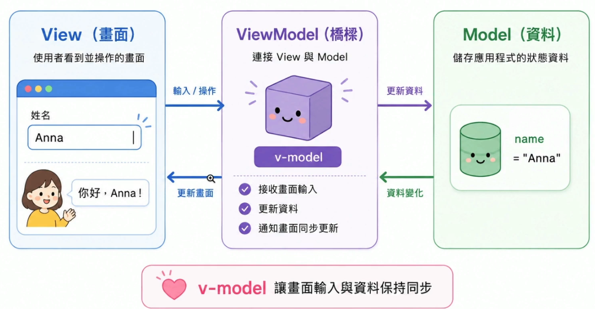

[🏠 回到首頁](../../README.md)

# 03-Vue.js 核心架構與資料綁定

## 3.1 MVVM 架構

### 1. MVVM 是什麼的縮寫？

| 縮寫   | 英文全名  | 中文 | 負責什麼                                   |
| ------ | --------- | ---- | ------------------------------------------ |
| **M**  | Model     | 資料 | 儲存應用程式的資料（例如 `name = "Anna"`） |
| **V**  | View      | 畫面 | 使用者看到、操作的畫面（HTML 模板）        |
| **VM** | ViewModel | 橋樑 | 連接 View 與 Model，讓兩邊保持同步         |

**MVVM 的意義：** 把「資料」和「畫面」分開，中間由 ViewModel 當橋樑自動同步。

> 💡 比喻：餐廳裡，**View** 是客人看到的菜單與餐桌，**Model** 是廚房裡的食材與庫存，**ViewModel** 是服務生：客人點餐（操作畫面）→ 服務生通知廚房（更新資料）；廚房備好餐（資料變化）→ 服務生送上桌（更新畫面）。



### 2. 資料如何流動？（以輸入姓名為例）

```
使用者在輸入框打字
   │  ① 輸入 / 操作
   ▼
 View（畫面）──▶ ViewModel（橋樑，v-model）──② 更新資料──▶ Model（name）
   ▲                                                         │
   └──────────── ④ 更新畫面 ◀── ViewModel ◀── ③ 資料變化 ────┘
```

1. 使用者在輸入框輸入姓名（View）。
2. `v-model` 接收輸入，更新 `name` 這筆資料（Model）。
3. `name` 改變了，Vue 偵測到資料變化。
4. Vue 自動更新畫面，「你好，Anna！」跟著變（View）。

重點：**我們不需要自己寫「找到元素、改 innerText」的程式**，只要改資料，畫面就會自動更新。這就是**資料驅動畫面**。

### 3. 實作：MVVM.html

使用 Composition API，輸入姓名後，畫面即時顯示問候語。

```html
<div id="app">
  <!-- View：畫面 -->
  <label>姓名：<input type="text" v-model="name" /></label>
  <p>你好，{{ name }}！</p>
</div>

<script src="https://unpkg.com/vue@3.5.13/dist/vue.global.prod.js"></script>
<script>
  const { createApp, ref } = Vue;

  createApp({
    setup() {
      // Model：資料。ref() 會把它變成「響應式資料」
      const name = ref("Anna");

      // ViewModel：把資料交給模板使用
      return { name };
    },
  }).mount("#app");
</script>
```

程式碼說明：

| 程式碼            | 說明                                                                  |
| ----------------- | --------------------------------------------------------------------- |
| `ref('Anna')`     | 建立響應式資料，初始值為 `'Anna'`。資料一變，使用它的畫面就會自動更新 |
| `setup()`         | Composition API 的入口，在這裡宣告資料與函式                          |
| `return { name }` | 把資料「交出去」，模板才能使用 `name`                                 |
| `v-model="name"`  | **雙向綁定**：輸入框改變 → `name` 改變；`name` 改變 → 輸入框也改變    |
| `{{ name }}`      | 插值語法，把 `name` 的內容顯示在畫面上                                |
| `.mount('#app')`  | 告訴 Vue 要管理哪一塊 HTML                                            |

> ⚠️ 執行方式：請在 VS Code 對 `MVVM.html` 按右鍵 → **Open with Live Server**。

> 💡 小提醒：在 `<script>` 中讀寫 `ref` 的值要用 `name.value`；在模板（HTML）中則直接寫 `name`，Vue 會自動處理。

## 3.2 Vue起手式

### 1. 何謂 Vue 元件？

**元件（Component）** 是「畫面的一小塊 + 它需要的資料與功能」包成的一個獨立單位。

> 💡 比喻：元件就像樂高積木。一個網頁由很多積木（按鈕、清單、導覽列…）組成，每塊積木各自負責自己的外觀與行為，可以重複使用。

本章的 `createApp({ ... })` 就是在建立最基本的元件（根元件）。

### 2. Vue 元件可拆成三個部分

| 部分        | 要回答的問題             | 做法                                    | 計數器範例                      |
| ----------- | ------------------------ | --------------------------------------- | ------------------------------- |
| 1. 資料     | 畫面需要使用哪些資料？   | 用 `ref()`、`reactive()` 建立響應式資料 | `count`（目前數字）             |
| 2. 功能     | 使用者操作時需要做什麼？ | 建立 JavaScript 函式                    | `add()`：將數字加 1             |
| 3. 生命週期 | 元件在不同階段要做什麼？ | 使用生命週期函式                        | `onMounted()`：顯示到畫面後執行 |

**1. 資料**

- `ref()`：適合單一值（數字、字串、布林），讀寫要用 `.value`。
- `reactive()`：適合物件，直接用屬性存取，不需要 `.value`。
- 兩者建立的資料都是「響應式」：資料改變，畫面自動更新。

**2. 功能**

- 就是一般的 JavaScript 函式，再用 `@click="add"` 綁定到按鈕。
- `@click` 是 `v-on:click` 的縮寫，意思是「點擊時執行」。

**3. 生命週期**

生命週期是指 Vue 元件從**建立、顯示、更新到最後被移除**所經歷的整個流程。
Vue 提供對應的生命週期函式，讓我們在元件進入特定階段時，執行需要的程式。

```
建立 ──▶ 顯示到畫面（onMounted）──▶ 資料改變、更新畫面（onUpdated）──▶ 移除（onUnmounted）
```

| 生命週期函式    | 執行時機                 | 常見用途                    |
| --------------- | ------------------------ | --------------------------- |
| `onMounted()`   | 元件顯示到畫面**之後**   | 呼叫 API 取得資料、操作 DOM |
| `onUpdated()`   | 畫面因資料改變而更新之後 | 少用，初學先認識即可        |
| `onUnmounted()` | 元件被移除之後           | 清除計時器、取消事件監聽    |

本節先會用 `onMounted()` 即可。

### 3. 實作：counter-vue.html（計數器）

```html
<div id="app">
  <h1>計數器</h1>
  <p>目前數字：{{ count }}</p>
  <button type="button" @click="add">+1</button>
</div>

<script src="https://unpkg.com/vue@3.5.13/dist/vue.global.prod.js"></script>
<script>
  const { createApp, ref, onMounted } = Vue;

  createApp({
    setup() {
      // 1. 資料
      const count = ref(0);

      // 2. 功能：數字加 1
      const add = () => {
        count.value++;
      };

      // 3. 生命週期：元件顯示到畫面後執行
      onMounted(() => {
        console.log("元件已顯示到畫面上");
      });

      return { count, add };
    },
  }).mount("#app");
</script>
```

執行流程：

1. 頁面載入，Vue 建立元件，`count` 為 `0`，畫面顯示「目前數字：0」。
2. 元件顯示到畫面後，執行 `onMounted()`，主控台印出訊息（按 F12 → Console 可看到）。
3. 使用者按下按鈕 → 執行 `add()` → `count.value` 變成 `1`。
4. 因為 `count` 是響應式資料，畫面自動更新為「目前數字：1」。

> ⚠️ 執行方式：請在 VS Code 對 `counter-vue.html` 按右鍵 → **Open with Live Server**。

### 4. 常見錯誤

| 錯誤                            | 原因                                          | 解法                         |
| ------------------------------- | --------------------------------------------- | ---------------------------- |
| 畫面顯示 `{{ count }}` 原文     | Vue 沒載入成功，或 `mount('#app')` 找不到元素 | 檢查 CDN 網址與 `id="app"`   |
| 點按鈕數字不變                  | 在 `<script>` 裡寫成 `count++`，忘了 `.value` | 改成 `count.value++`         |
| 模板出現 `count is not defined` | 忘了在 `setup()` 中 `return`                  | 加上 `return { count, add }` |

## 3.3 單筆資料呈現與雙向資料綁定

當使用者在表單輸入「草莓蛋糕」後，建立響應式資料，讓資料呈現在畫面上。
當資料有多筆時，則改用陣列與物件來建立響應式資料。

### 1. 單筆資料呈現：`{{ }}`

步驟：

1. 在 `setup()` 用 `ref()` 建立響應式資料。
2. 用 `return` 交給模板。
3. 在模板用 `{{ 變數名稱 }}` 把資料顯示到畫面上。

```html
<p>{{ dessert }}</p>
```

```js
const dessert = ref("草莓蛋糕");
return { dessert };
```

> 💡 `{{ }}` 稱為「插值（Interpolation）」，是**單向**：資料 → 畫面。資料改變，畫面跟著變；但畫面本身不會反過來改資料。

### 2. 雙向資料綁定：`v-model`

表單輸入框需要「使用者輸入 → 資料」的方向，這時使用 `v-model`，同時完成兩個方向：

```
資料 ◀──────▶ 畫面
      v-model
```

| 方向          | 說明                                 | 範例                           |
| ------------- | ------------------------------------ | ------------------------------ |
| 資料 → 畫面   | 資料有初始值，輸入框一開始就顯示它   | 輸入框一開始顯示「草莓蛋糕」   |
| 畫面 → 資料   | 使用者輸入文字，資料立刻跟著更新     | 改輸入「提拉米蘇」，資料也更新 |

```html
<input type="text" v-model="dessert" />
<p>你輸入的是：{{ dessert }}</p>
```

與 3.1 的 MVVM 對照：`v-model` 就是 View 與 ViewModel 之間的「雙向綁定」，不需要自己寫 `addEventListener` 去監聽輸入。

### 3. 實作：single-data.html（單筆資料）

```html
<div id="app">
  <h1>甜點訂購</h1>
  <label>
    品項：
    <input type="text" v-model="dessert" placeholder="請輸入甜點名稱" />
  </label>
  <p>你輸入的是：{{ dessert }}</p>
  <button type="button" @click="reset">重設為草莓蛋糕</button>
</div>

<script src="https://unpkg.com/vue@3.5.13/dist/vue.global.prod.js"></script>
<script>
  const { createApp, ref } = Vue;

  createApp({
    setup() {
      // 1. 資料：單筆資料用 ref
      const dessert = ref("草莓蛋糕");

      // 2. 功能：在 <script> 中修改資料要用 .value
      const reset = () => {
        dessert.value = "草莓蛋糕";
      };

      return { dessert, reset };
    },
  }).mount("#app");
</script>
```

執行流程：

1. 頁面載入，`dessert` 為「草莓蛋糕」，輸入框與段落都顯示「草莓蛋糕」。
2. 使用者在輸入框改打「提拉米蘇」→ `v-model` 即時更新 `dessert` → 段落同步變成「提拉米蘇」。
3. 按下按鈕 → `dessert.value` 被改回「草莓蛋糕」→ 輸入框與段落也同步更新（資料 → 畫面）。

> ⚠️ 執行方式：請在 VS Code 對 `single-data.html` 按右鍵 → **Open with Live Server**。

### 4. 多筆資料：陣列與物件

現實中的資料常常不只一筆，也不只一個欄位，依形狀選擇建立方式：

| 資料形狀             | 範例                                     | 建議做法    | 在 `<script>` 中讀寫  |
| -------------------- | ---------------------------------------- | ----------- | --------------------- |
| 單一值               | `"草莓蛋糕"`                             | `ref()`     | `dessert.value`       |
| 一筆資料、多個欄位   | `{ name: "草莓蛋糕", price: 120 }`       | `reactive()`| `form.name`           |
| 多筆資料（陣列）     | `[{...}, {...}, {...}]`                  | `ref([])`   | `desserts.value.push` |

```js
// 多筆資料：陣列裡每一筆是一個物件
const desserts = ref([
  { id: 1, name: "草莓蛋糕", price: 120 },
  { id: 2, name: "提拉米蘇", price: 150 },
  { id: 3, name: "布丁", price: 60 },
]);

// 一筆資料、多個欄位（例如表單）
const form = reactive({ name: "", price: null });
```

呈現多筆資料時，用 `v-for` 逐筆產生畫面（第 4 章會詳細說明）：

```html
<li v-for="item in desserts" :key="item.id">{{ item.name }} - NT$ {{ item.price }}</li>
```

- `item`：目前這一筆資料，用 `item.name` 取得欄位。
- `:key`：給每筆資料一個**唯一**的識別值（通常用 `id`），讓 Vue 能正確更新畫面。

表單欄位也可以直接綁定到物件屬性：

```html
<input type="text" v-model.trim="form.name" />
<input type="number" v-model.number="form.price" />
```

> 💡 `v-model.trim` 會自動去除前後空白；`v-model.number` 會把輸入值轉成數字（否則輸入框的值預設是字串）。

### 5. 實作：multi-data.html（多筆資料）

```html
<div id="app">
  <h1>甜點訂購</h1>

  <h2>新增甜點</h2>
  <form @submit.prevent="addDessert">
    <input type="text" v-model.trim="form.name" placeholder="名稱" />
    <input type="number" v-model.number="form.price" placeholder="價格" />
    <button type="submit">新增</button>
  </form>
  <p>輸入中：{{ form.name }} / NT$ {{ form.price }}</p>

  <h2>甜點清單（共 {{ desserts.length }} 筆）</h2>
  <ul>
    <li v-for="item in desserts" :key="item.id">{{ item.name }} - NT$ {{ item.price }}</li>
  </ul>
</div>

<script src="https://unpkg.com/vue@3.5.13/dist/vue.global.prod.js"></script>
<script>
  const { createApp, ref, reactive } = Vue;

  createApp({
    setup() {
      const desserts = ref([
        { id: 1, name: "草莓蛋糕", price: 120 },
        { id: 2, name: "提拉米蘇", price: 150 },
        { id: 3, name: "布丁", price: 60 },
      ]);

      const form = reactive({ name: "", price: null });

      const addDessert = () => {
        if (!form.name || form.price === null) return;
        desserts.value.push({ id: Date.now(), name: form.name, price: form.price });
        form.name = "";
        form.price = null;
      };

      return { desserts, form, addDessert };
    },
  }).mount("#app");
</script>
```

執行流程：

1. 頁面載入，`desserts` 有 3 筆資料，`v-for` 產生 3 個 `<li>`。
2. 使用者輸入名稱與價格，`form` 的欄位透過 `v-model` 即時更新，「輸入中」那行同步顯示。
3. 按下「新增」→ 表單 `submit` → 執行 `addDessert()`，用 `push` 加入陣列，並清空表單。
4. `desserts` 是響應式資料，畫面自動多出一筆，標題的筆數也跟著變成 4。

> ⚠️ 執行方式：請在 VS Code 對 `multi-data.html` 按右鍵 → **Open with Live Server**。

### 6. `ref` 與 `reactive` 比較

| 項目             | `ref()`                              | `reactive()`                        |
| ---------------- | ------------------------------------ | ----------------------------------- |
| 適用資料         | 任何型別（單一值、物件、陣列皆可）   | 只能用在物件（含陣列）              |
| `<script>` 中存取 | 要加 `.value`                        | 直接用屬性，不需要 `.value`         |
| 模板中存取       | 不需要 `.value`                      | 不需要 `.value`                     |
| 整個替換         | 可以：`list.value = []`              | 不可以直接替換整個變數（會失去響應）|

> 💡 初學建議：**一律先用 `ref()`**，不容易出錯；表單欄位多的物件再考慮 `reactive()`。

### 7. 常見錯誤

| 錯誤                                   | 原因                                             | 解法                                           |
| -------------------------------------- | ------------------------------------------------ | ---------------------------------------------- |
| 輸入框打字，畫面文字不會變             | 用 `:value="dessert"`（單向）而不是 `v-model`    | 改用 `v-model="dessert"`                       |
| 在 `<script>` 裡 `dessert = "布丁"` 沒反應 | `ref` 忘了 `.value`                          | 改成 `dessert.value = "布丁"`                  |
| `desserts.push(...)` 報錯              | 陣列包在 `ref` 內，忘了 `.value`                 | 改成 `desserts.value.push(...)`                |
| 價格 `100 + 50` 變成 `10050`           | `type="number"` 的 `v-model` 預設仍是字串        | 使用 `v-model.number`                          |
| `v-for` 出現 key 警告                  | 沒加 `:key`，或 key 重複                         | 加上唯一的 `:key="item.id"`                    |

---

## 📝 練習題

> 範圍：3.1 MVVM 架構、3.2 Vue 起手式、3.3 單筆資料呈現與雙向資料綁定
> 建議做法：先自己作答，再展開「答案與詳解」對照。

---

### 一、選擇題（共 6 題）

#### Q1. 在 MVVM 架構中，負責「連結 View 與 Model，並處理資料綁定」的是哪一個？

- (A) Model
- (B) View
- (C) ViewModel
- (D) Controller

<details>
<summary>答案與詳解</summary>

**答案：(C)**

Model 是資料、View 是畫面，**ViewModel** 位於兩者之間，負責雙向綁定：資料變了更新畫面，使用者操作畫面也會回寫資料。在 Vue 中，這個角色就是元件（`setup()` 回傳的內容）。

</details>

#### Q2. 已知 `const count = ref(0)`，下列哪一個寫法能在 `<script>` 中**正確**讓數字加 1？

- (A) `count++`
- (B) `count.value++`
- (C) `count = count + 1`
- (D) `{{ count++ }}`

<details>
<summary>答案與詳解</summary>

**答案：(B)**

`ref` 會把值包在物件裡，在 `<script>` 中讀寫必須透過 `.value`。(A)(C) 沒有 `.value`，無法觸發更新（(C) 還會因為 `const` 報錯）；(D) 是在模板中，不應拿來修改資料。

</details>

#### Q3. 下列程式碼，畫面最後會顯示什麼？

```html
<div id="app">
  <p>{{ title }}</p>
</div>
<script>
  const { createApp, ref } = Vue;
  createApp({
    setup() {
      const title = ref("草莓蛋糕");
    },
  }).mount("#app");
</script>
```

- (A) 草莓蛋糕
- (B) 空白，且主控台出現 `title` 未定義的警告
- (C) `{{ title }}`
- (D) undefined

<details>
<summary>答案與詳解</summary>

**答案：(B)**

`setup()` 裡的變數必須用 `return { title }` 交給模板，否則模板找不到 `title`，會顯示空白並在 Console 出現警告。

</details>

#### Q4. 關於 `{{ }}` 與 `v-model`，下列敘述何者**正確**？

- (A) `{{ }}` 與 `v-model` 都是雙向綁定
- (B) `{{ }}` 是單向（資料 → 畫面），`v-model` 是雙向
- (C) `v-model` 只能用在 `<p>` 標籤
- (D) `{{ }}` 可以讓使用者輸入並回寫資料

<details>
<summary>答案與詳解</summary>

**答案：(B)**

`{{ }}` 只負責把資料顯示出來（單向）；`v-model` 用在 `<input>`、`<textarea>`、`<select>` 等表單元素，同時完成「資料 → 畫面」與「畫面 → 資料」。

</details>

#### Q5. 使用者在 `<input v-model="price">` 輸入 `100`，若希望 `price` 的值是**數字** `100` 而不是字串，應該怎麼寫？

- (A) `<input v-model="price" type="text">`
- (B) `<input v-model.trim="price">`
- (C) `<input v-model.number="price">`
- (D) `<input :value.number="price">`

<details>
<summary>答案與詳解</summary>

**答案：(C)**

`v-model.number` 會把輸入值轉成數字。`.trim` 只是去除前後空白，不會轉型；(D) 不是正確用法，而且單向綁定不會回寫資料。

</details>

#### Q6. 已知 `const list = ref([{ id: 1, name: "布丁" }])`，要在 `<script>` 中新增一筆資料，下列哪一個寫法**正確**？

- (A) `list.push({ id: 2, name: "蛋糕" })`
- (B) `list.value.push({ id: 2, name: "蛋糕" })`
- (C) `list.value = { id: 2, name: "蛋糕" }`
- (D) `{{ list.push({ id: 2, name: "蛋糕" }) }}`

<details>
<summary>答案與詳解</summary>

**答案：(B)**

陣列包在 `ref` 內，在 `<script>` 中要先取 `.value` 才是真正的陣列，再呼叫 `push`。(A) 忘了 `.value` 會報錯；(C) 會把陣列換成單一物件，資料型別就錯了。

</details>

---

### 二、實作題（共 2 題）

#### 實作 1：留言預覽（單筆資料、v-model、生命週期）

請使用 CDN 的 Vue 3，完成下列需求：

1. 畫面有一個輸入框，使用 `v-model` 綁定 `message`，初始值為「你好，Vue！」。
2. 輸入框下方用 `{{ }}` 即時顯示「預覽：xxx」。
3. 再顯示「字數：N」，N 為 `message` 的字數（提示：`message.length`）。
4. 加一個「清空」按鈕，點擊後 `message` 變成空字串。
5. 使用 `onMounted()`，在元件顯示後於 Console 印出「元件已顯示」。

<details>
<summary>答案與詳解</summary>

```html
<!doctype html>
<html lang="zh-Hant">
  <head>
    <meta charset="UTF-8" />
    <title>留言預覽</title>
  </head>
  <body>
    <div id="app">
      <h1>留言預覽</h1>
      <input type="text" v-model="message" />
      <p>預覽：{{ message }}</p>
      <p>字數：{{ message.length }}</p>
      <button type="button" @click="clear">清空</button>
    </div>

    <script src="https://unpkg.com/vue@3.5.13/dist/vue.global.prod.js"></script>
    <script>
      const { createApp, ref, onMounted } = Vue;

      createApp({
        setup() {
          const message = ref("你好，Vue！");

          const clear = () => {
            message.value = "";
          };

          onMounted(() => {
            console.log("元件已顯示");
          });

          return { message, clear };
        },
      }).mount("#app");
    </script>
  </body>
</html>
```

**詳解：**

- `v-model="message"` 同時完成雙向綁定，輸入時預覽與字數都會即時更新。
- `{{ message.length }}`：`{{ }}` 內可以放表達式，直接取字串長度即可。
- 在 `<script>` 中清空要寫 `message.value = ""`；按下按鈕後輸入框也會被清空（資料 → 畫面）。
- `onMounted` 需要先從 `Vue` 解構取出，並在 `setup()` 內呼叫。

</details>

#### 實作 2：甜點清單（多筆資料、reactive、v-for）

請完成下列需求：

1. 準備一個甜點陣列 `desserts`（`ref`），至少 3 筆，每筆含 `id`、`name`、`price`。
2. 用 `v-for` 列出甜點，顯示「名稱 - NT$ 價格」，並加上正確的 `:key`。
3. 用 `reactive` 建立 `form`（含 `name`、`price`），輸入框分別使用 `v-model.trim` 與 `v-model.number`。
4. 放在 `<form>` 中，使用 `@submit.prevent`；按「新增」後把資料加入清單並清空表單（名稱或價格未填不新增）。
5. 標題顯示「共 N 筆」，N 為目前清單筆數。
6. 清單下方顯示「總金額：NT$ X」，X 為所有甜點價格總和（提示：使用 `reduce`）。

<details>
<summary>答案與詳解</summary>

```html
<!doctype html>
<html lang="zh-Hant">
  <head>
    <meta charset="UTF-8" />
    <title>甜點清單</title>
  </head>
  <body>
    <div id="app">
      <h1>甜點清單（共 {{ desserts.length }} 筆）</h1>

      <form @submit.prevent="addDessert">
        <input type="text" v-model.trim="form.name" placeholder="名稱" />
        <input type="number" v-model.number="form.price" placeholder="價格" />
        <button type="submit">新增</button>
      </form>

      <ul>
        <li v-for="item in desserts" :key="item.id">{{ item.name }} - NT$ {{ item.price }}</li>
      </ul>

      <p>總金額：NT$ {{ total() }}</p>
    </div>

    <script src="https://unpkg.com/vue@3.5.13/dist/vue.global.prod.js"></script>
    <script>
      const { createApp, ref, reactive } = Vue;

      createApp({
        setup() {
          const desserts = ref([
            { id: 1, name: "草莓蛋糕", price: 120 },
            { id: 2, name: "提拉米蘇", price: 150 },
            { id: 3, name: "布丁", price: 60 },
          ]);

          const form = reactive({ name: "", price: null });

          const addDessert = () => {
            if (!form.name || form.price === null) return;
            desserts.value.push({ id: Date.now(), name: form.name, price: form.price });
            form.name = "";
            form.price = null;
          };

          // 總金額：每次畫面更新時重新計算（第 4 章之後可改用 computed）
          const total = () => desserts.value.reduce((sum, item) => sum + item.price, 0);

          return { desserts, form, addDessert, total };
        },
      }).mount("#app");
    </script>
  </body>
</html>
```

**詳解：**

- 多筆資料用 `ref([...])`，在 `<script>` 中操作要寫 `desserts.value.push(...)`；在模板中直接寫 `desserts.length`。
- `form` 是一筆資料、多個欄位，用 `reactive` 最直覺，直接寫 `form.name`，不需要 `.value`。
- `v-model.number` 讓價格是數字，否則 `reduce` 相加時會變成字串串接（如 `"120" + "150"`）。
- `:key` 使用唯一的 `id`；新增時用 `Date.now()` 產生不重複的 id。
- 模板中呼叫函式需要加括號，所以總金額要寫成 `{{ total() }}`。

</details>
