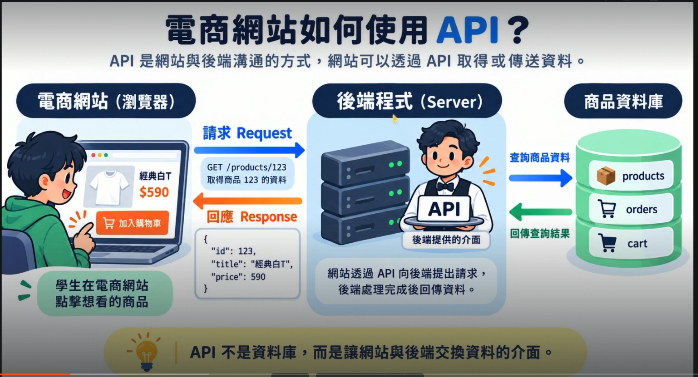

[🏠 回到首頁](../../README.md)

# 05-API 串接與 Vite 專案 GitHub Pages 部署

## 5.1 課程API的申請與串接



**API（Application Programming Interface，應用程式介面）**：是網站（前端）與後端溝通的方式，網站可以透過API取得或傳送資料。**API不是資料庫，而是讓網站與後端交換資料的介面。**

以電商網站為例，流程如下：

1. 使用者在瀏覽器（前端）點擊想看的商品
2. 前端發出**請求（Request）**，例如：`GET /products/123`（取得商品123的資料）
3. 後端程式（Server）收到請求後，向**資料庫**查詢商品資料（products、orders、cart等）
4. 資料庫回傳查詢結果給後端
5. 後端將結果以**回應（Response）**回傳給前端，格式通常為JSON：

```json
{
  "id": 123,
  "title": "經典白T",
  "price": 590
}
```

6. 前端取得資料後，將內容渲染到畫面上（如商品名稱、價格）

> 簡單比喻：前端是客人，API是服務生，後端與資料庫是廚房。客人不會直接進廚房，而是透過服務生點餐與取餐。

[課程API申請](https://vue3-course-api.hexschool.io/)

### 5.1.1 Vite環境變數配置

[Vite環境變數配置](https://vite.dev/guide/env-and-mode)

環境變數按照使用環境不同，通常拆分成

1. 通用環境變數(`.env`)
2. 開發環境變數(`.env.development`)
3. 正式(生產)環境變數(`.env.production`)

開發環境：`.env`+`.env.development`
正式(生產)環境：`.env`+`.env.production`

在Vite專案中，如果要自訂環境變數，變數名稱需要以VITE\_開頭，才能在前端程式正常使用。

像是`VITE_API_URL`這類設定，開發環境和正式環境通常會連接不同的API端點，因此可以分別放在`.env.development`與`.env.production`中管理，讓Vite根據目前的執行環境載入對應的設定
例如：

1. 通用環境變數：所有環境變數都會載入`VITE_API_NAME`
2. 開發環境變數：開發時使用`VITE_API_URL`
3. 正式(生產)環境變數：正式部署時使用`VITE_API_URL`

Vite常用終端機指令

> npm create vite@latest # 建立框架

> npm install # 安裝相關套件

> npm run dev # 專案啟動，專案停止按下Ctrl+C

> npm run build # 打包正式版

> npm run preview # 本地打包預覽結果

> npm run deploy # 部署

> npm add -D sass-embedded # 安裝Scss預處理器

> npm run lint # 執行ESLint檢查程式碼，找出語法錯誤與不符合規範的寫法（Vite專案若有安裝ESLint才會有此指令）

## 5.2 Vite 專案 GitHub Pages 部署流程

### 不使用GitHub Action的作法：https://weiyun0912.github.io/Wei-Docusaurus/docs/Vite/Vite-Github-Pages/

摘錄網站內容（使用`gh-pages`套件手動部署）：

1. 安裝`gh-pages`套件（開發依賴）

```bash
npm install gh-pages --save-dev
```

2. 設定`vite.config.js`的`base`為`/Repo名稱/`（以下以Repo名稱`vite-react-project`為例）

```js
import { defineConfig } from "vite";
import react from "@vitejs/plugin-react";

export default defineConfig({
  base: "/vite-react-project/",
  plugins: [react()],
});
```

3. 在`package.json`的`scripts`加入`predeploy`與`deploy`

```json
"scripts": {
  "dev": "vite",
  "build": "vite build",
  "preview": "vite preview",
  "predeploy": "npm run build",
  "deploy": "gh-pages -d dist"
}
```

- `predeploy`：執行`npm run deploy`前會自動先執行，負責打包產生`dist`資料夾
- `deploy`：將`dist`資料夾的內容推送到GitHub Pages使用的分支（預設為`gh-pages`分支）

4. 執行部署指令

```bash
npm run deploy
```

5. 到GitHub Repo的Settings/Pages設定來源分支（Branch選`gh-pages`），等待片刻後即可取得網址，例如：`https://帳號.github.io/vite-react-project/`

> 缺點：每次部署都需要在本機手動執行指令。

### 講師的作法：

在Github開新的Repo後，Settings/Pages/Source: Github Actions

#### GitHub Action、Workflow與CI/CD的意義與關係

- **CI/CD**：一種軟體開發的觀念（做法）
  - **CI（Continuous Integration，持續整合）**：程式碼每次提交後，自動安裝套件、檢查、測試、打包，及早發現問題
  - **CD（Continuous Delivery/Deployment，持續交付/部署）**：通過檢查後，自動將成果部署到伺服器或網站
- **GitHub Actions**：GitHub提供的自動化服務，是實現CI/CD的工具
- **Workflow（工作流程）**：在GitHub Actions中定義的一套自動化流程，由YAML檔案描述，一個Repo可有多個Workflow
- 關係：CI/CD是「概念」→ GitHub Actions是「工具」→ Workflow是「實際要執行的流程設定」

#### YAML是一種怎樣的檔案？

- 副檔名為`.yml`或`.yaml`（筆記原文的「ymal」為筆誤）
- 是一種以**縮排**表示階層、以`key: value`表示資料的設定檔格式，可讀性高，比JSON更簡潔
- 縮排必須使用**空白**（不可用Tab），常用於各種工具的設定檔
- 範例：

```yaml
name: 範例
items:
  - apple
  - banana
```

#### Workflow所定義的YAML檔案內容

檔案位置固定放在專案的`.github/workflows/`資料夾，例如`.github/workflows/deploy.yml`。內容大致包含：

- `name`：Workflow名稱
- `on`：觸發條件（如push到main分支、手動觸發）
- `permissions`：授權GitHub Pages部署所需的權限
- `jobs`：要執行的工作，每個job包含執行環境`runs-on`與步驟`steps`
  - 取得程式碼（`actions/checkout`）
  - 安裝Node.js（`actions/setup-node`）
  - 安裝套件（`npm ci`）
  - 打包（`npm run build`）
  - 上傳打包成果（`actions/upload-pages-artifact`）
  - 部署到GitHub Pages（`actions/deploy-pages`）

```yaml
name: Deploy to GitHub Pages

on:
  push:
    branches: [main]
  workflow_dispatch:

permissions:
  contents: read
  pages: write
  id-token: write

jobs:
  build:
    runs-on: ubuntu-latest
    steps:
      - uses: actions/checkout@v4
      - uses: actions/setup-node@v4
        with:
          node-version: 20
      - run: npm ci
      - run: npm run build
      - uses: actions/upload-pages-artifact@v3
        with:
          path: dist

  deploy:
    needs: build
    runs-on: ubuntu-latest
    environment:
      name: github-pages
    steps:
      - uses: actions/deploy-pages@v4
```

> 注意：`vite.config.js`的`base`仍需設為`/Repo名稱/`，否則部署後會找不到資源（頁面空白）。

#### 自動化部署流程

Push→觸發Workflow→自動執行→Deploy部署

1. **Push**：將程式碼推送到GitHub（main分支）
2. **觸發Workflow**：GitHub偵測到符合`on`的條件，啟動對應的Workflow
3. **自動執行**：GitHub的虛擬機依序執行`steps`（安裝、打包）
4. **Deploy部署**：將`dist`成果發佈到GitHub Pages，完成後即可透過網址瀏覽

#### 後續自動化部署的流程

有的，部署完成後只要持續開發，流程就會自動循環：

1. 本機修改程式碼 → `git add`、`git commit`、`git push`
2. 到GitHub的**Actions**頁籤查看執行狀態（成功✅／失敗❌，失敗可點進去看log排錯）
3. 成功後重新整理網站（必要時清除快取）即可看到更新
4. 若要進一步擴充，可在Workflow加入`npm run lint`、測試等步驟，檢查未通過就不部署（完整的CI/CD）

---

## 📝 練習題

> 範圍：5.1 課程 API 的申請與串接、5.2 Vite 專案 GitHub Pages 部署流程
> 本章節習題只出選擇題，不出實作題。建議先自己作答，再展開「答案與詳解」對照。

### 選擇題（共 12 題）

#### Q1. 下列關於 API 的敘述，何者**正確**？

- (A) API 就是資料庫本身
- (B) API 是讓網站（前端）與後端交換資料的介面
- (C) API 只能由後端工程師使用，前端無法呼叫
- (D) API 回傳的資料一定是 HTML

<details>
<summary>答案與詳解</summary>

**答案：(B)**

API **不是資料庫**，而是前後端溝通、交換資料的介面；前端發出 Request，後端處理後回傳 Response（通常為 JSON）。

</details>

#### Q2. 前端發出 `GET /products/123` 的請求，目的為何？

- (A) 新增一筆商品 123
- (B) 刪除商品 123
- (C) 取得商品 123 的資料
- (D) 修改商品 123 的價格

<details>
<summary>答案與詳解</summary>

**答案：(C)**

`GET` 用於**取得資料**；新增通常用 `POST`、修改用 `PUT`/`PATCH`、刪除用 `DELETE`。

</details>

#### Q3. 在 Vite 專案中，自訂環境變數需以什麼開頭，才能在前端程式中使用？

- (A) `API_`
- (B) `VUE_`
- (C) `VITE_`
- (D) `ENV_`

<details>
<summary>答案與詳解</summary>

**答案：(C)**

Vite 只會把以 `VITE_` 開頭的變數暴露給前端程式，並透過 `import.meta.env.VITE_XXX` 讀取。

</details>

#### Q4. 執行 `npm run dev` 時，Vite 會載入哪些環境變數檔？

- (A) `.env` + `.env.production`
- (B) `.env` + `.env.development`
- (C) 只有 `.env.development`
- (D) 只有 `.env.production`

<details>
<summary>答案與詳解</summary>

**答案：(B)**

開發環境載入 `.env` 與 `.env.development`；正式環境（`npm run build`）載入 `.env` 與 `.env.production`。

</details>

#### Q5. 下列哪一個指令的用途是「在本地預覽打包後的結果」？

- (A) `npm run dev`
- (B) `npm run build`
- (C) `npm run preview`
- (D) `npm run deploy`

<details>
<summary>答案與詳解</summary>

**答案：(C)**

`build` 負責打包產生 `dist`；`preview` 則是在本地啟動伺服器預覽打包結果。

</details>

#### Q6. 下列關於 CI/CD、GitHub Actions、Workflow 的關係，何者**正確**？

- (A) CI/CD 是 GitHub 的專屬產品
- (B) GitHub Actions 是實現 CI/CD 的工具，Workflow 是其中定義的自動化流程
- (C) Workflow 是一種程式語言
- (D) GitHub Actions 只能用來部署，不能執行測試

<details>
<summary>答案與詳解</summary>

**答案：(B)**

CI/CD 是觀念；GitHub Actions 是 GitHub 提供的自動化工具；Workflow 是以 YAML 描述的實際流程，可包含安裝、測試、打包、部署等步驟。

</details>

#### Q7. GitHub Actions 的 Workflow 設定檔（YAML）應放在專案的哪個位置？

- (A) `src/workflows/`
- (B) `.github/workflows/`
- (C) `public/workflows/`
- (D) 專案根目錄的 `workflow.json`

<details>
<summary>答案與詳解</summary>

**答案：(B)**

固定放在 `.github/workflows/` 資料夾，副檔名為 `.yml` 或 `.yaml`。

</details>

#### Q8. 關於 YAML 檔案，下列敘述何者**錯誤**？

- (A) 以縮排表示階層
- (B) 以 `key: value` 表示資料
- (C) 縮排可以使用 Tab 鍵
- (D) 常用於各種工具的設定檔

<details>
<summary>答案與詳解</summary>

**答案：(C)**

YAML 的縮排必須使用**空白**，不可使用 Tab，否則會解析錯誤。

</details>

#### Q9. Workflow 中的 `on: push: branches: [main]` 代表什麼意思？

- (A) 每天固定時間自動執行
- (B) 手動點擊按鈕才會執行
- (C) 當程式碼 push 到 main 分支時觸發
- (D) 當建立 Issue 時觸發

<details>
<summary>答案與詳解</summary>

**答案：(C)**

`on` 定義觸發條件，此設定表示 push 到 `main` 分支時啟動 Workflow。

</details>

#### Q10. 下列何者是使用 GitHub Actions 自動部署 Vite 專案的正確流程？

- (A) Deploy 部署 → Push → 觸發 Workflow → 自動執行
- (B) Push → 觸發 Workflow → 自動執行（安裝、打包）→ Deploy 部署
- (C) 自動執行 → Push → Deploy 部署 → 觸發 Workflow
- (D) 觸發 Workflow → Deploy 部署 → Push → 自動執行

<details>
<summary>答案與詳解</summary>

**答案：(B)**

先 push 程式碼，觸發 Workflow，GitHub 自動安裝套件並打包，最後將 `dist` 部署到 GitHub Pages。

</details>

#### Q11. 部署 Vite 專案到 GitHub Pages 時，`vite.config.js` 的 `base` 通常要設為何？

- (A) `/`
- (B) `/Repo名稱/`
- (C) `/dist/`
- (D) `/gh-pages/`

<details>
<summary>答案與詳解</summary>

**答案：(B)**

GitHub Pages 的網址為 `帳號.github.io/Repo名稱/`，`base` 若未設定為 `/Repo名稱/`，部署後會找不到資源而出現空白頁。

</details>

#### Q12. 不使用 GitHub Actions，改用 `gh-pages` 套件部署時，`npm run deploy` 前會自動先執行哪個 script？

- (A) `prebuild`
- (B) `predeploy`
- (C) `postdeploy`
- (D) `preview`

<details>
<summary>答案與詳解</summary>

**答案：(B)**

npm 會在執行 `deploy` 前自動執行 `predeploy`（內容為 `npm run build`），再用 `gh-pages -d dist` 推送 `dist`。

</details>
