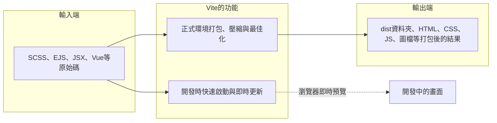

[🏠 回到首頁](../../README.md)

# 08-Vite 開發環境與套件整合

## 8.1 Vite環境安裝

### 8.1.1 Vite 的運作流程



**名詞解釋**

| 名詞                    | 意義                                                                                                      |
| ----------------------- | --------------------------------------------------------------------------------------------------------- |
| **輸入端**              | 開發者實際撰寫的檔案，瀏覽器無法直接看懂，需要經過轉換                                                    |
| **SCSS**                | CSS 的進階語法（支援變數、巢狀、mixin），需編譯成一般 CSS                                                 |
| **EJS**                 | 嵌入 JavaScript 的 HTML 樣板語言，可用來產生重複的 HTML 結構                                              |
| **JSX**                 | React 使用的語法，可在 JavaScript 裡直接寫類似 HTML 的標籤，需編譯成純 JS                                 |
| **Vue**                 | 指 `.vue` 單檔元件（SFC），把 template、script、style 寫在同一個檔案，需編譯後才能執行                    |
| **原始碼**              | 開發階段撰寫、尚未經過編譯或打包的程式碼                                                                  |
| **Vite的功能**          | 中間的建構工具，負責「開發」與「打包」兩件事                                                              |
| **開發時快速啟動**      | 啟動開發伺服器（`npm run dev`）時不需先把整個專案打包，而是瀏覽器需要哪個檔案才即時轉換哪個，所以啟動很快 |
| **即時更新（HMR）**     | Hot Module Replacement，修改存檔後，瀏覽器只會更新有變動的模組，不用重新整理整頁，也能保留目前的畫面狀態  |
| **正式環境打包**        | 執行 `npm run build`，把所有模組合併成少量檔案，供部署上線使用                                            |
| **壓縮**                | 移除空白、註解並縮短變數名稱，讓檔案體積變小、載入更快                                                    |
| **最佳化**              | 包含 Tree Shaking（移除沒用到的程式碼）、程式碼分割、檔名加上雜湊值（Hash）以利快取等                     |
| **輸出端**              | 打包完成後，可直接部署到伺服器的成果                                                                      |
| **dist資料夾**          | `distribution`（發佈）的縮寫，`npm run build` 後產生的資料夾，上線時只需要部署這個資料夾                  |
| **HTML、CSS、JS、圖檔** | 瀏覽器能直接讀懂的標準檔案；SCSS 會被編譯成 CSS，Vue/JSX 會被編譯成 JS                                    |

> 重點：**開發時**追求「快」（不打包、即時更新）；**上線時**追求「小」與「穩」（打包、壓縮、最佳化）。

### 8.1.2 Vite 安裝過程

Vite安裝過程如下：

1. 在終端機輸入`node -v`確認Node.js版本，建議使用20.19.0以上
2. 在終端機輸入`npm create vite@latest`來建立框架（依提示輸入專案名稱，選擇 Vue 與 JavaScript / TypeScript）
3. 進入專案目錄，先輸入`npm install`安裝套件，再輸入`npm run dev`啟動專案，專案停止按下`Ctrl+C`

```bash
node -v                    # 確認 Node.js 版本
npm create vite@latest     # 建立專案
cd my-vue-app              # 進入專案資料夾
npm install                # 安裝套件
npm run dev                # 啟動開發伺服器（預設 http://localhost:5173）
```

常用指令：

| 指令              | 用途                            |
| ----------------- | ------------------------------- |
| `npm run dev`     | 啟動開發伺服器（含 HMR）        |
| `npm run build`   | 打包正式環境，輸出到 `dist/`    |
| `npm run preview` | 在本機預覽打包後的 `dist/` 結果 |

### 8.1.3 Vite專案結構說明

```text
my-vue-app/
├─ .vscode/               # VS Code 編輯器的專案設定
├─ node_modules/          # 所有安裝的套件
├─ public/                # 靜態資源
├─ src/                   # 原始碼主要資料夾
│  ├─ api/
│  │  └─ axios.js         # 集中管理 API 請求
│  ├─ assets/             # 會被打包處理的資源
│  ├─ components/         # 元件
│  ├─ App.vue             # 根元件
│  └─ main.js             # 程式進入點
├─ .env                   # 環境變數
├─ .gitignore             # Git 忽略清單
├─ index.html             # 專案入口 HTML
├─ package.json           # 專案設定與套件清單
├─ package-lock.json      # 鎖定套件版本
├─ README.md              # 專案說明文件
└─ vite.config.ts         # Vite 設定檔
```

| 檔案／資料夾        | 主要用途                                                                                                     |
| ------------------- | ------------------------------------------------------------------------------------------------------------ |
| `.vscode/`          | 存放 VS Code 專案設定（如建議安裝的擴充套件 `extensions.json`），方便團隊統一開發環境                        |
| `node_modules/`     | `npm install` 後下載的所有套件；**體積龐大，不要上傳 Git**，也不要手動修改                                   |
| `public/`           | 靜態資源（如 `favicon.ico`、`robots.txt`），**不經打包處理，原封不動複製到 `dist/` 根目錄**，用 `/檔名` 引用 |
| `src/`              | 所有開發的原始碼都放在這裡                                                                                   |
| `src/api/axios.js`  | 集中建立 axios 實例與 API 函式（如 `APIGetUsers`），讓元件不必重複寫網址                                     |
| `src/assets/`       | 圖片、字型、SCSS 等資源，**會經過 Vite 處理**（壓縮、加上雜湊檔名）                                          |
| `src/components/`   | 可重複使用的 Vue 元件                                                                                        |
| `src/App.vue`       | 根元件，所有畫面都從這裡開始往下組合                                                                         |
| `src/main.js`       | 應用程式進入點：`createApp(App)`、註冊 Router、Pinia 等外掛，最後 `.mount('#app')`                           |
| `.env`              | 環境變數（變數名稱要以 `VITE_` 開頭才能在前端使用）；若含敏感資訊，不建議上傳 Git                            |
| `.gitignore`        | 告訴 Git 哪些檔案不要版控，如 `node_modules`、`dist`、`.env.local`                                           |
| `index.html`        | Vite 的入口 HTML，含 `<div id="app">` 與 `<script type="module" src="/src/main.js">`                         |
| `package.json`      | 專案名稱、版本、`scripts` 指令（dev / build / preview）、`dependencies` 與 `devDependencies`                 |
| `package-lock.json` | 鎖定實際安裝的套件版本，確保團隊與部署環境安裝結果一致；**不要手動修改**                                     |
| `vite.config.ts`    | Vite 設定檔，可設定外掛、路徑別名、開發伺服器、打包輸出等（詳見 8.3）                                        |
| `README.md`         | 專案說明文件（如何安裝、啟動、部署）                                                                         |

> `public/` 與 `src/assets/` 的差異：`public/` 原封不動複製；`src/assets/` 會被 Vite 處理（壓縮、雜湊檔名），建議優先放在 `src/assets/`。

## 8.2 Vite整合Axios與環境變數

### 8.2.1 環境變數 `.env`

```bash
# .env
VITE_API_URL=https://ec-course-api.hexschool.io/v2
VITE_API_PATH=你的API_PATH
```

- 在程式中使用 `import.meta.env.VITE_XXX` 讀取
- 沒有 `VITE_` 開頭的變數，Vite 不會暴露給前端（避免意外洩漏）
- 修改 `.env` 後，**需重新啟動** `npm run dev` 才會生效

### 8.2.2 安裝 Axios

```bash
npm install axios
```

### 8.2.3 範例程式碼

axios.js

```js
import axios from "axios";
const axiosInstance = axios.create({
  baseURL: import.meta.env.VITE_API_PATH,
});
const APIGetUsers = async () => {
  return await axiosInstance.get("/users");
};

export { APIGetUsers };
```

axios-env.vue

```vue
<script setup>
import { ref, onMounted } from "vue";
import { APIGetUsers } from ".api/axios.js";
const users = ref([]);
onMounted(async () => {
  await APIGetUsers();
  users.value = response.data;
});
</script>
<template>{{ users }}</template>
```

### 8.2.4 程式碼解釋

**① axios.js（API 請求的集中管理檔）**

| 程式碼                                     | 說明                                                                                                           |
| ------------------------------------------ | -------------------------------------------------------------------------------------------------------------- |
| `import axios from 'axios'`                | 匯入 axios 套件（需先 `npm install axios`）                                                                    |
| `axios.create({...})`                      | 建立一個**客製化的 axios 實例**，之後所有請求都會套用這份共用設定                                              |
| `baseURL: import.meta.env.VITE_API_PATH`   | 設定請求的**基底網址**，值來自 `.env` 的 `VITE_API_PATH`。之後只寫 `/users`，實際請求就是「基底網址 + /users」 |
| `const APIGetUsers = async()=>{...}`       | 把「取得使用者」包成一個函式，元件只要呼叫它，不必知道網址細節                                                 |
| `return await axiosInstance.get('/users')` | 發送 `GET` 請求並回傳 axios 的回應物件（資料放在 `response.data`）                                             |
| `export {APIGetUsers}`                     | 具名匯出，讓其他檔案可以用 `import {APIGetUsers}` 引入                                                         |

好處：網址統一由環境變數管理，開發／正式環境只要換 `.env` 就能切換；日後要加 token、攔截器（interceptors）也只需改這一個地方。

**② axios-env.vue（元件，呼叫 API 並顯示結果）**

| 程式碼                                      | 說明                                                                          |
| ------------------------------------------- | ----------------------------------------------------------------------------- |
| `<script setup>`                            | Composition API 的語法糖，宣告的變數與函式可直接用在 template                 |
| `import {ref, onMounted} from 'vue'`        | `ref` 建立響應式資料；`onMounted` 是元件掛載完成後執行的生命週期鉤子          |
| `import {APIGetUsers} from '.api/axios.js'` | 匯入剛才寫好的 API 函式                                                       |
| `const users=ref([])`                       | 建立響應式陣列，初始為空，等 API 回來後填入                                   |
| `onMounted(async()=>{...})`                 | 元件畫面掛載後才發送請求，因為要使用 `await`，所以傳入 `async` 函式           |
| `await APIGetUsers()`                       | 等待 API 回應                                                                 |
| `users.value=response.data`                 | 把回應中的資料存入 `users`，畫面會自動更新（`ref` 在 script 中要用 `.value`） |
| `<template>{{ users }}</template>`          | 把 `users` 以 JSON 字串形式顯示在畫面上                                       |

**③ 上面範例有 3 個錯誤，需要修正**

| 問題                       | 原因                                                                      | 修正                                                   |
| -------------------------- | ------------------------------------------------------------------------- | ------------------------------------------------------ |
| 匯入路徑 `'.api/axios.js'` | 少了 `/`，會被當成套件名稱而找不到                                        | 改成 `'./api/axios.js'`，或使用別名 `'@/api/axios.js'` |
| `response` 未定義          | `await APIGetUsers()` 的結果沒有存進變數                                  | 改成 `const response = await APIGetUsers()`            |
| `VITE_API_PATH` 命名不當   | 它存的是「API 網址」，命名為 `VITE_API_URL` 更貼切（`.env` 與程式要一致） | 統一命名為 `VITE_API_URL`                              |

修正後：

```js
// src/api/axios.js
import axios from "axios";

const axiosInstance = axios.create({
  baseURL: import.meta.env.VITE_API_URL,
});

const APIGetUsers = async () => {
  return await axiosInstance.get("/users");
};

export { APIGetUsers };
```

```vue
<script setup>
import { ref, onMounted } from "vue";
import { APIGetUsers } from "./api/axios.js";

const users = ref([]);

onMounted(async () => {
  const response = await APIGetUsers();
  users.value = response.data;
});
</script>

<template>{{ users }}</template>
```

> 進階：實務上建議加上 `try...catch` 處理請求失敗，並用 `loading`、`error` 狀態提示使用者。

## 8.3 vite.config.ts常用與進階設定

`vite.config.ts` 是 Vite 的設定檔，用 `defineConfig` 包起來可以獲得完整的型別提示。

### 8.3.1 基本結構

```ts
import { defineConfig } from "vite";
import vue from "@vitejs/plugin-vue";

export default defineConfig({
  plugins: [vue()],
});
```

### 8.3.2 常用設定

#### ① `plugins`：外掛

讓 Vite 認得 `.vue` 檔，或加入額外功能。

```ts
plugins: [vue()];
```

常見外掛：`@vitejs/plugin-vue`（Vue 支援）、`vite-plugin-vue-devtools`（開發工具）、`unplugin-auto-import`（自動匯入 API）。

#### ② `base`：部署的基底路徑

部署到 **GitHub Pages**（網址為 `https://帳號.github.io/專案名稱/`）時，必須設定成 `/專案名稱/`，否則 JS、CSS 會找不到而白畫面。

```ts
base: '/my-vue-app/',
```

#### ③ `resolve.alias`：路徑別名

用 `@` 代表 `src`，避免出現 `../../../` 的相對路徑。

```ts
import { fileURLToPath, URL } from 'node:url'

resolve: {
  alias: {
    '@': fileURLToPath(new URL('./src', import.meta.url)),
  },
},
```

使用：`import { APIGetUsers } from '@/api/axios.js'`

#### ④ `server`：開發伺服器

```ts
server: {
  port: 3000,       // 指定埠號（預設 5173）
  open: true,       // 啟動後自動開啟瀏覽器
  host: true,       // 允許區網其他裝置連線（手機測試）
},
```

#### ⑤ `build`：打包設定

```ts
build: {
  outDir: 'dist',        // 輸出資料夾（預設 dist）
  sourcemap: false,      // 是否產生 sourcemap，方便除錯，正式環境通常關閉
  chunkSizeWarningLimit: 1000, // 單一檔案超過多少 KB 才警告
},
```

### 8.3.3 進階設定

#### ① `server.proxy`：解決開發時的跨域（CORS）

開發時將請求轉發給後端，瀏覽器以為在同一個網域，就不會有 CORS 問題。

```ts
server: {
  proxy: {
    '/api': {
      target: 'https://ec-course-api.hexschool.io',
      changeOrigin: true,                    // 修改請求標頭的 Origin
      // rewrite: (path) => path.replace(/^\/api/, ''), // 需要時移除前綴
    },
  },
},
```

> proxy **只在開發階段有效**，正式環境需由後端設定 CORS 或使用伺服器反向代理。

#### ② `defineConfig` 函式寫法與 `loadEnv`：依環境調整設定

```ts
import { defineConfig, loadEnv } from "vite";

export default defineConfig(({ mode }) => {
  // 第三個參數 '' 代表讀取所有變數（不限 VITE_ 開頭）
  const env = loadEnv(mode, process.cwd(), "");

  return {
    base: mode === "production" ? "/my-vue-app/" : "/",
    server: {
      proxy: {
        "/api": { target: env.VITE_API_URL, changeOrigin: true },
      },
    },
  };
});
```

`mode` 預設值：`npm run dev` 為 `development`，`npm run build` 為 `production`。

#### ③ `build.rollupOptions`：程式碼分割

把大型套件獨立拆成檔案，利用瀏覽器快取、加快載入。

```ts
build: {
  rollupOptions: {
    output: {
      manualChunks: {
        vue: ['vue', 'vue-router', 'pinia'],
        axios: ['axios'],
      },
    },
  },
},
```

#### ④ `css.preprocessorOptions`：全域注入 SCSS

```ts
css: {
  preprocessorOptions: {
    scss: {
      additionalData: `@use "@/assets/scss/variables" as *;`,
    },
  },
},
```

#### ⑤ `envDir` / `envPrefix`：自訂環境變數

```ts
envDir: './env',          // .env 檔案改放在指定資料夾
envPrefix: 'VITE_',       // 暴露給前端的前綴（不建議改成空字串，會洩漏機密）
```

#### ⑥ 其他實用設定

| 設定                      | 說明                                                              |
| ------------------------- | ----------------------------------------------------------------- |
| `server.strictPort`       | 埠號被占用時直接報錯，而不是自動換埠                              |
| `build.target`            | 指定打包後支援的瀏覽器版本                                        |
| `build.minify`            | 壓縮方式（預設 `esbuild`），可設 `false` 方便除錯                 |
| `build.assetsInlineLimit` | 小於此大小（預設 4KB）的圖片會轉成 base64 內嵌                    |
| `esbuild.drop`            | 打包時移除 `console`、`debugger`：`drop: ['console', 'debugger']` |
| `define`                  | 定義全域常數，打包時會直接替換                                    |
| `preview.port`            | `npm run preview` 的埠號                                          |

### 8.3.4 完整範例

```ts
import { defineConfig, loadEnv } from "vite";
import vue from "@vitejs/plugin-vue";
import { fileURLToPath, URL } from "node:url";

export default defineConfig(({ mode }) => {
  const env = loadEnv(mode, process.cwd(), "");

  return {
    base: mode === "production" ? "/my-vue-app/" : "/",
    plugins: [vue()],
    resolve: {
      alias: { "@": fileURLToPath(new URL("./src", import.meta.url)) },
    },
    server: {
      port: 3000,
      open: true,
      proxy: {
        "/api": { target: env.VITE_API_URL, changeOrigin: true },
      },
    },
    build: {
      sourcemap: false,
      rollupOptions: {
        output: { manualChunks: { vue: ["vue", "vue-router", "pinia"] } },
      },
    },
  };
});
```

> 修改 `vite.config.ts` 後，需要**重新啟動**開發伺服器才會生效。

---

## 📝 練習題

> 範圍：8.1 Vite 環境安裝、8.2 Vite 整合 Axios 與環境變數、8.3 vite.config.ts 設定
> 建議先自己作答，再展開「答案與詳解」對照。

### 選擇題（共 10 題）

#### Q1. 下列何者是 Vite 在「開發階段」的主要特色？

- (A) 每次啟動都要先把整個專案打包完成
- (B) 快速啟動並支援即時更新（HMR）
- (C) 只能開發 Vue，不能開發 React
- (D) 必須先執行 `npm run build`

<details>
<summary>答案與詳解</summary>

**答案：(B)**

Vite 開發時不需先打包，瀏覽器需要哪個模組才轉換哪個，所以啟動快；修改後 HMR 只更新有變動的模組。

</details>

#### Q2. 執行 `npm run build` 之後，打包結果預設會輸出在哪個資料夾？

- (A) `public`
- (B) `src`
- (C) `dist`
- (D) `node_modules`

<details>
<summary>答案與詳解</summary>

**答案：(C)**

預設輸出到 `dist`，可由 `build.outDir` 修改。上線部署的就是這個資料夾。

</details>

#### Q3. 下列何者**不是**輸入端會出現的檔案類型？

- (A) SCSS
- (B) JSX
- (C) Vue
- (D) dist 資料夾

<details>
<summary>答案與詳解</summary>

**答案：(D)**

`dist` 是打包後的**輸出端**成果；SCSS、JSX、Vue 都是需要被轉換的原始碼。

</details>

#### Q4. 關於 `public/` 與 `src/assets/`，下列敘述何者正確？

- (A) 兩者都會經過 Vite 處理並加上雜湊檔名
- (B) `public/` 的檔案不經打包處理，原封不動複製到輸出資料夾
- (C) `src/assets/` 的檔案不會被打包
- (D) `public/` 只能放 `.vue` 檔

<details>
<summary>答案與詳解</summary>

**答案：(B)**

`public/` 為靜態資源，原樣複製；`src/assets/` 會被 Vite 處理（壓縮、雜湊檔名）。

</details>

#### Q5. 下列哪個檔案用來「鎖定實際安裝的套件版本」，且不應手動修改？

- (A) `package.json`
- (B) `package-lock.json`
- (C) `vite.config.ts`
- (D) `.gitignore`

<details>
<summary>答案與詳解</summary>

**答案：(B)**

`package-lock.json` 記錄實際安裝的版本，確保團隊與部署環境安裝結果一致。

</details>

#### Q6. 在 Vite 專案中，要在程式裡讀取 `.env` 內的 `VITE_API_URL`，正確寫法為何？

- (A) `process.env.VITE_API_URL`
- (B) `import.meta.env.VITE_API_URL`
- (C) `window.env.VITE_API_URL`
- (D) `require('VITE_API_URL')`

<details>
<summary>答案與詳解</summary>

**答案：(B)**

Vite 使用 `import.meta.env` 讀取環境變數，且變數名稱必須以 `VITE_` 開頭才會暴露給前端。

</details>

#### Q7. 在 `axios.create({ baseURL: ... })` 中設定 `baseURL` 的作用為何？

- (A) 讓所有請求自動加上同一個基底網址
- (B) 限制只能發送 `GET` 請求
- (C) 自動將資料存入 `localStorage`
- (D) 取代 `async/await`

<details>
<summary>答案與詳解</summary>

**答案：(A)**

設定後只需寫 `get('/users')`，實際請求為「baseURL + /users」，開發與正式環境換 `.env` 即可切換。

</details>

#### Q8. 下列程式碼為什麼會出錯？

```js
onMounted(async () => {
  await APIGetUsers();
  users.value = response.data;
});
```

- (A) `onMounted` 不能搭配 `async`
- (B) `response` 沒有被宣告，應寫 `const response = await APIGetUsers()`
- (C) `ref` 不需要 `.value`
- (D) `await` 只能用在 `<template>`

<details>
<summary>答案與詳解</summary>

**答案：(B)**

`await APIGetUsers()` 的回傳值沒有存進變數，所以 `response` 未定義。`onMounted` 可以傳入 `async` 函式。

</details>

#### Q9. 專案要部署到 GitHub Pages（網址為 `https://帳號.github.io/my-app/`），`vite.config.ts` 中應設定哪一項？

- (A) `base: '/my-app/'`
- (B) `server.port: 80`
- (C) `build.minify: false`
- (D) `resolve.alias: '/my-app/'`

<details>
<summary>答案與詳解</summary>

**答案：(A)**

`base` 決定資源的基底路徑；未設定會導致 JS、CSS 路徑錯誤而白畫面。

</details>

#### Q10. 開發時想解決呼叫後端 API 的跨域（CORS）問題，最適合使用 `vite.config.ts` 的哪個設定？

- (A) `build.outDir`
- (B) `server.proxy`
- (C) `css.preprocessorOptions`
- (D) `envPrefix`

<details>
<summary>答案與詳解</summary>

**答案：(B)**

`server.proxy` 會由開發伺服器轉發請求，瀏覽器視為同網域所以不會有 CORS 問題。注意：**只在開發階段有效**。

</details>
